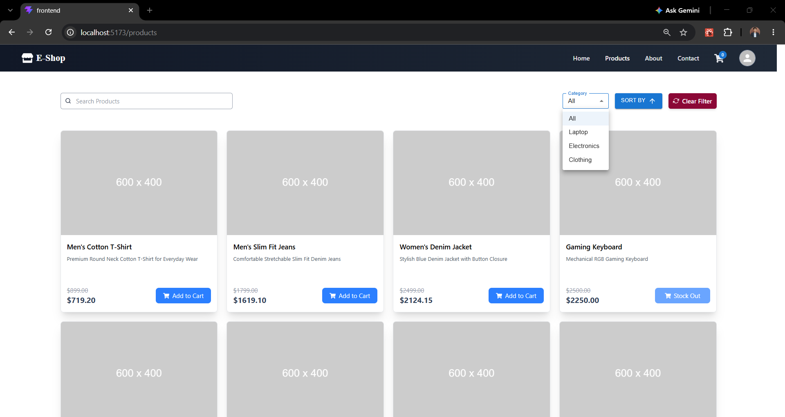
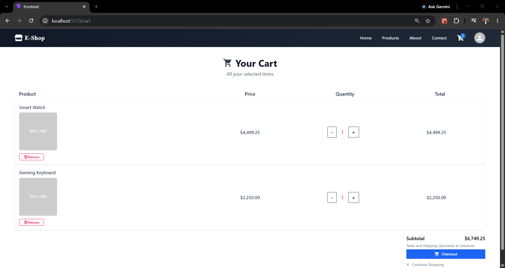
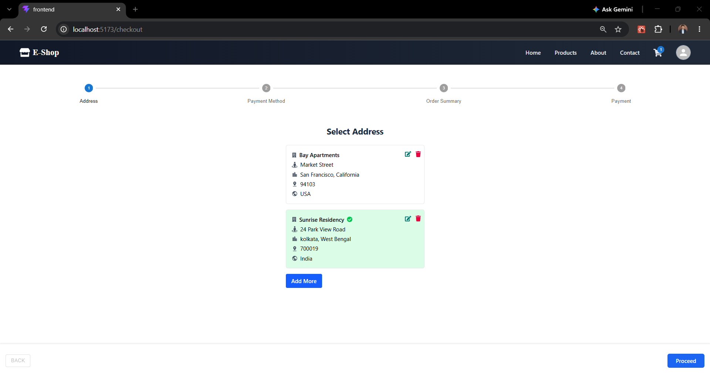

<h1>🛒 Full-Stack E-Commerce Application</h1>

  A full-stack e-commerce web application built with <strong>Spring Boot</strong> and <strong>React</strong>, featuring user authentication, product browsing, shopping cart management, secure checkout, and order placement.

  The application provides a seamless shopping experience with a responsive frontend and a RESTful backend.

<h2>✨ Features</h2>

<ul>
  <li><strong>User Authentication</strong> – User registration and login with JWT-based authentication.</li>
  <li><strong>Product Catalog</strong> – Browse and explore available products.</li>
  <li><strong>Shopping Cart</strong> – Add, remove, and manage products in the cart.</li>
  <li><strong>Checkout</strong> – Review cart items and manage delivery information.</li>
  <li><strong>Payment Integration</strong> – Secure payment processing using Stripe.</li>
  <li><strong>Order Summary</strong> – View order details and confirm purchases.</li>
  <li><strong>Responsive UI</strong> – User-friendly interface for different screen sizes.</li>
  <li><strong>RESTful APIs</strong> – Backend APIs developed using Spring Boot.</li>
</ul>

<h2>🛠️ Tech Stack</h2>

<h3>Backend</h3>
<ul>
  <li>Java</li>
  <li>Spring Boot</li>
  <li>Spring Security</li>
  <li>Spring Data JPA</li>
  <li>PostgreSQL</li>
  <li>JWT Authentication</li>
  <li>Stripe Payment Integration</li>
  <li>Maven</li>
</ul>

<h3>Frontend</h3>
<ul>
  <li>React</li>
  <li>JavaScript</li>
  <li>Redux Toolkit</li>
  <li>Tailwind CSS</li>
  <li>Axios</li>
  <li>Vite</li>
</ul>

<h2>📸 Application Screenshots</h2>

<h3>🏠 Home Page</h3>

  

<h3>🔐 Login Page</h3>

  

<h3>📝 Registration Page</h3>

  

<h3>🛍️ Product Catalog</h3>

  

<h3>🛒 Shopping Cart</h3>

  

<h3>📝 Select Address</h3>

  

<h3>📋 Order Summary</h3>

  

<h3>💳 Payment Method</h3>

  

<h2>🚀 Getting Started</h2>

<h3>Prerequisites</h3>

<ul>
  <li>Java 17 or later</li>
  <li>Node.js and npm</li>
  <li>PostgreSQL</li>
  <li>Stripe account and API keys</li>
</ul>

<h3>Backend Setup</h3>

<strong>1. Clone the repository:</strong>

<pre>
git clone &lt;your-repository-url&gt;
cd &lt;your-repository-folder&gt;
</pre>

<strong>2. Configure your PostgreSQL database and update the application configuration.</strong>

<strong>3. Configure your Stripe API keys in the backend environment or configuration file.</strong>

<strong>4. Run the Spring Boot application:</strong>

<pre>
./mvnw spring-boot:run
</pre>

<h3>Frontend Setup</h3>

<strong>1. Navigate to the frontend directory:</strong>

<pre>
cd frontend
</pre>

<strong>2. Install dependencies:</strong>

<pre>
npm install
</pre>

<strong>3. Configure the backend URL in your environment variables.</strong>

<strong>4. Start the React development server:</strong>

<pre>
npm run dev
</pre>

<h2>📂 Project Structure</h2>

<pre>
├── backend/          # Spring Boot REST API
├── frontend/         # React application
├── asset/            # Application screenshots
└── README.md
</pre>

<h2>🔐 Security</h2>

<ul>
  <li>JWT-based authentication and authorization</li>
  <li>Protected routes for authenticated users</li>
  <li>Secure payment processing through Stripe</li>
  <li>Role-based access control</li>
</ul>

<h2>👨‍💻 Author</h2>

<strong>Suvam Debnath</strong>

  GitHub:
  <a href="https://github.com/Suvam-Debnath">Suvam-Debnath</a>

